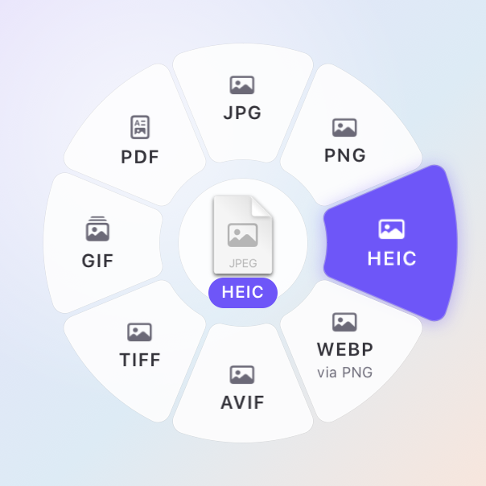
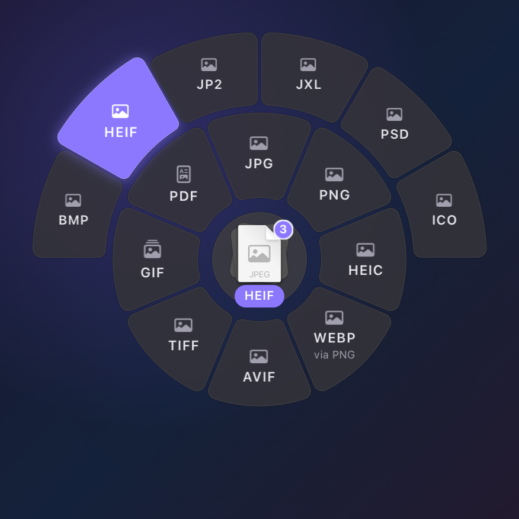
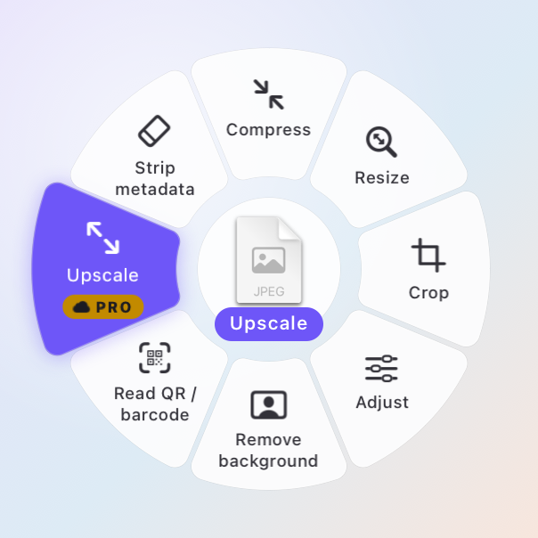
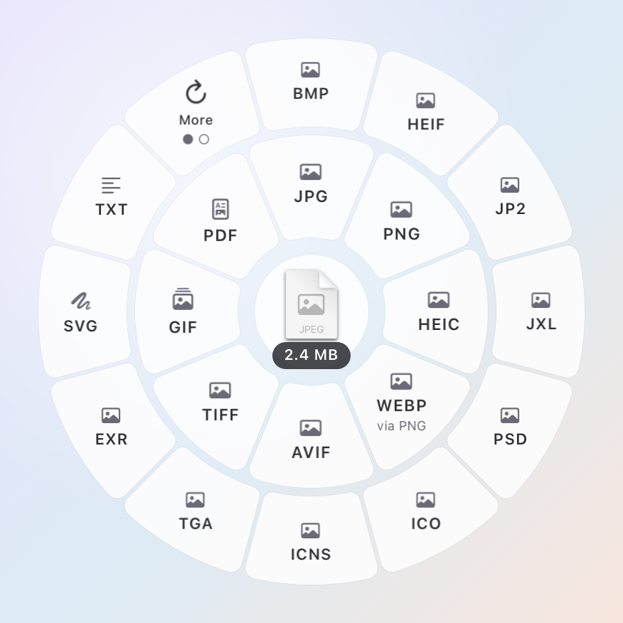
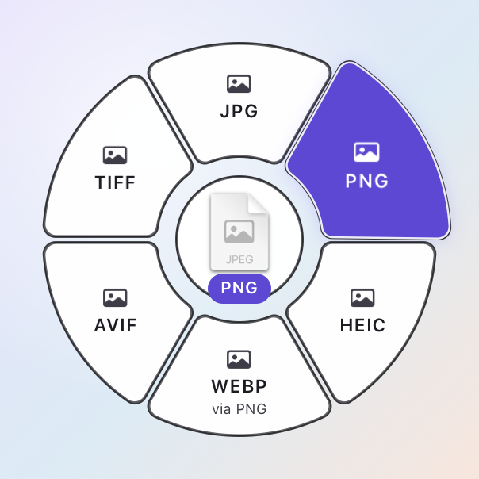
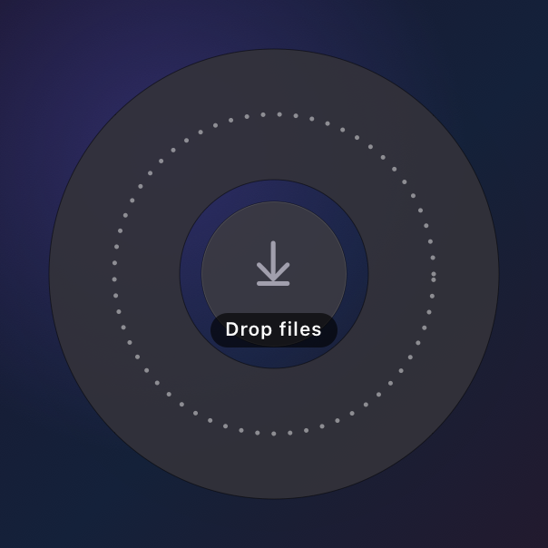

# RadialMenu

A radial (pie) menu for macOS 13+, drawn entirely with Core Animation. It's
built to appear **in the middle of another app's drag** and take the drop,
but it works just as well in any window with the mouse or keyboard.

MIT licensed. No dependencies. Part of [anyfmt](../../README.md), usable on its own.

| | | |
|---|---|---|
|  |  |  |
|  |  |  |

Screenshots live in `Screenshots/` and are rendered offscreen with
`RadialMenuSnapshot` (vibrancy is painted there; on screen it's real).

## What you get

- **Angular hit testing.** The whole wedge is the target, gaps included; the
  ring is picked by radius; a dead zone in the hub means "nothing" (a drop there
  is refused). Slight overshoot past the outer edge still hits. 1.5° of
  hysteresis stops flicker on boundaries.
- **Rings and pages, never an overflow menu.** Up to 8 items: one ring, item 0
  at 12 o'clock, clockwise. 9–20: a second ring of fixed-width wedges that fills
  outward from 12 o'clock. Beyond that the outer ring pages (11 items + a "More"
  segment at 11 o'clock that flips on hover-dwell, click, Page Up/Down or scroll,
  with page dots).
- **Motion on layers only.** Hover is a spring (response 0.25, damping 0.8) on
  the wedge path plus a quick accent fill; open fans segments out of the hub with
  a stagger that always fits 150 ms; close collapses toward a point; switching
  item sets morphs every wedge to its new angles while labels crossfade. Wedge
  paths share one fixed element structure so Core Animation can interpolate any
  wedge into any other. No Swift runs per frame.
- **Real vibrancy.** An `NSVisualEffectView` (popover or HUD material) masked by
  per-segment shape layers that animate with the segments, plus a hairline inner
  stroke and soft per-wedge shadows drawn underneath.
- **Accessibility.** Reduce Motion (crossfades only), Increase Contrast (solid
  fills, strong strokes), Reduce Transparency (opaque material), light and dark.
  VoiceOver sees one radio button per segment with label, hint and selected
  state; page flips and host-driven switches can be announced.
- **Keyboard.** ←/→ move in angular order, ↑/↓ change ring, Return chooses,
  Escape cancels, Tab/Shift-Tab ask the host for the next/previous item set,
  1–9 jump to an item.
- **A drag-overlay panel.** `RadialMenuPanel` is a borderless, non-activating
  panel at `.popUpMenu` level (above the menu bar and Dock, below the drag
  image), on every Space and over full-screen apps. It registers drag types
  before it's ever shown, paints its whole hit disc with a minimum alpha
  (transparent pixels never receive drags), centres on a point and is pushed
  inward near screen edges (multi-display, Retina-snapped, with a top band kept
  clear). If it had to be pushed, nothing is selected until the pointer moves.
- **Offscreen snapshots** for docs, galleries and regression images.

## Usage

```swift
import RadialMenu

final class Controller: RadialMenuViewDelegate {
    let panel = RadialMenuPanel()  // file URLs + file promises by default

    init() {
        panel.menuView.delegate = self
        panel.prewarm()  // optional: pay window-server setup at launch
    }

    func show(at point: CGPoint) {  // global coordinates, e.g. NSEvent.mouseLocation
        panel.menuView.menuTitle = "Convert"
        panel.menuView.hub = RadialHubContent(image: icon, stackCount: 1, idleText: "2.4 MB")
        panel.menuView.setItems([
            RadialItem(id: "jpg", title: "JPG", symbolName: "photo", prominence: .title),
            RadialItem(id: "png", title: "PNG", symbolName: "photo", subtitle: "via TIFF", prominence: .title),
            RadialItem(id: "up", title: "Upscale", symbolName: "arrow.up.backward.and.arrow.down.forward",
                       badge: "Pro", accessorySymbolName: "icloud.fill"),
        ], animated: false)
        panel.show(at: point)
    }

    func radialMenu(_ menu: RadialMenuView, didDrop info: NSDraggingInfo, on item: RadialItem) -> Bool {
        let urls = info.draggingPasteboard.readObjects(forClasses: [NSURL.self],
                                                        options: [.urlReadingFileURLsOnly: true]) as? [URL] ?? []
        // … do the work …
        panel.confirmDrop(at: panel.convertPoint(toScreen: info.draggingLocation))
        return true
    }

    func radialMenuDidCancel(_ menu: RadialMenuView) { panel.dismiss() }
    func radialMenu(_ menu: RadialMenuView, didRequestNextMenu forward: Bool) {
        panel.menuView.setItems(otherItems, animated: true)  // morphs in place
    }
}
```

- Keyboard mode: `panel.allowsKeyboard = true` before `show` (the panel becomes
  key; activate your app first). Leave it off during drags so the source app
  keeps focus.
- Empty "drop here" ring: set `menuView.dropZone` with no items and implement
  `radialMenu(_:didDropOnEmptyRing:)`.
- Watching the mouse button yourself? It goes up a few milliseconds before AppKit
  delivers the drop, so don't close the panel then. If `menuView.acceptsCurrentDrop`
  is true a drop is on its way. If it's false (released over the hub, a gap or a
  disabled item), AppKit won't deliver one and you can close at once.
- Options per item: return true from `radialMenu(_:hasOptionsFor:)`; right-click
  or a 600 ms hover dwell calls `radialMenu(_:didRequestOptionsFor:anchor:)`.
- In your own window: `RadialMenuView(configuration:style:materialMode:)` is a
  plain `NSView` (446 × 446 pt canvas by default).
- Snapshots: `RadialMenuSnapshot.render(items:configuration:style:appearance:hoveredIndex:size:…)`
  returns an `NSImage`; `pngData(_:)` encodes it.

Everything about geometry, type and timing is in `RadialMenuConfiguration`;
colours, material and forced appearance in `RadialMenuStyle`; the strings the
menu draws itself ("More", page announcements) in `RadialMenuStrings`.

## Material

Both `.popover` and `.hudWindow` are supported (`RadialMenuStyle.material`).
`.popover` is the default: it reads as a bright frosted surface in light mode
and a deep smoky one in dark, so labels hold contrast over busy wallpapers.
`.hudWindow` is darker and more see-through.

## Tests

```bash
swift test
```

Layout for 1–60 items (angles, ring split, pagination, every item reachable),
angular hit testing (wrap-around at 12 o'clock, dead zone, partial outer arc,
hysteresis), edge push-in for every edge, corner and multi-display layout,
keyboard order, VoiceOver elements, panel recipe, and snapshot rendering in
every appearance.

## Licence

MIT. See [LICENSE](LICENSE).
