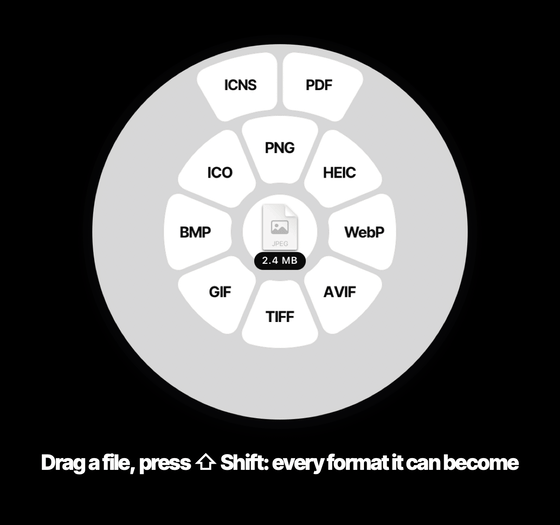

<p align="center">
  
</p>

<h1 align="center">anyfmt</h1>

<p align="center"><b>Drag a file. Tap a key. Drop it on what you want.</b><br>
A free, open-source file converter that lives in your Mac's menu bar.</p>

<p align="center">
  
</p>

---

Start dragging any file in Finder and **press ⇧ Shift** (tap it or hold it): a wheel of every format
that file can become opens around your pointer. Drop on a segment and a
converted copy appears beside the original. **Press ⌘ Command** for tools
(compress, crop, trim, remove background…) and **⌃ Control** for actions
(AirDrop, Float, Copy, Move, Copy Path, Terminal).

- **Everything runs on your Mac.** No uploads, no account, no analytics. The
  bundled ffmpeg is built without network support.
- **Free, including commercial use.** Every conversion, tool and action is free
  forever. You can read every line (AGPL-3.0).
- **Nothing to install.** ffmpeg, x264/x265, VP9, AV1, Opus, WebP and the SVG
  renderer ship inside the app. You never need Homebrew.
- **Never overwrites.** Results are always new files: `photo.jpg`, then `photo 2.jpg`.

Inspired by drag-to-convert tools.

## Install

**Requirements:** a Mac with Apple silicon, macOS 13 Ventura or later.

- Download the latest `anyfmt-x.y.z.dmg` from [Releases](https://github.com/AatmanAJ/anyfmt/releases) and drag anyfmt to Applications, or
- `brew install --cask aiwithaj/tap/anyfmt`

anyfmt appears in the menu bar. There's no Dock icon and no main window.

## Using it

| Do this mid-drag | You get |
|---|---|
| Tap **⇧ Shift** | **Convert**: only the formats this file (or every file in a multi-file drag) can become |
| Tap **⌘ Command** | **Tools**: compress, resize, crop, adjust, annotate, redact, remove/add background, collage, images → PDF, read QR codes, trim, crop video, change speed, split, join, snapshot, compress video, trim audio, normalize, bleep, channels, metadata, merge/split PDF, compress PDF |
| Tap **⌃ Control** | **Actions**: AirDrop, Float shelf, Copy, Move, Copy Path, open in Terminal. Works on folders and mixed selections too |

- Let go of the key and keep dragging: the wheel **stays open** until you drop
  or move back to the centre to cancel.
- Press another key to **switch wheels** without letting go of the file.
- Hover over a format for a moment mid-drag (or right-click it in keyboard mode) to set **options**:
  quality, target size, DPI, codec and more.
- **No dragging?** Select files in Finder and use **Finder › Services ›
  Open in anyfmt Wheel** (bind it to any shortcut), or press **⌃⌥Space** to open an
  empty ring you can drop files onto.
- Keys are remappable in **Settings › Keys**.

## Permissions, honestly

**The wheel needs no permissions at all.** anyfmt watches the mouse button and
modifier keys (the same public state any app can read) and the system drag
pasteboard, which every app can read. It never logs keystrokes, and it can't:
it doesn't see ordinary keys.

Two optional extras ask for more, and both are off until you turn them on:

| Feature | Permission | Why |
|---|---|---|
| Press Return on a Finder selection to open the wheel | **Accessibility** | To catch Return before Finder starts renaming the file |
| | **Automation → Finder** | To ask Finder which files are selected |
| Export to `.pages` / open `.key` `.numbers` | **Automation → Pages / Keynote / Numbers** | anyfmt asks your installed iWork apps to do the conversion |

Update checks are also opt-in. When they're on, anyfmt fetches an appcast once a
day and sends nothing else.

## Formats

<!-- formats:start (generated by `make readme-formats`) -->
| Category | From | On the wheel | Also available (opt-in, CLI) |
|---|---|---|---|
| Image | JPG | PNG, HEIC, WebP, AVIF, TIFF, GIF, BMP, ICO, ICNS, PDF | HEIF, JP2, PSD, TGA, EXR, DOCX, MD, TXT, HTML, RTF, RTFD, ODT, PPTX, XLSX, EPUB |
| Image | PNG | JPG, HEIC, WebP, AVIF, TIFF, GIF, BMP, ICO, ICNS, PDF | HEIF, JP2, PSD, TGA, EXR, DOCX, MD, TXT, HTML, RTF, RTFD, ODT, PPTX, XLSX, EPUB |
| Image | HEIC | JPG, PNG, WebP, AVIF, TIFF, GIF, BMP, ICO, ICNS, PDF | HEIF, JP2, PSD, TGA, EXR, DOCX, MD, TXT, HTML, RTF, RTFD, ODT, PPTX, XLSX, EPUB |
| Image | WebP | JPG, PNG, HEIC, AVIF, TIFF, GIF, BMP, ICO, ICNS, PDF | HEIF, JP2, PSD, TGA, EXR, DOCX, MD, TXT, HTML, RTF, RTFD, ODT, PPTX, XLSX, EPUB |
| Image | AVIF | JPG, PNG, HEIC, WebP, TIFF, GIF, BMP, ICO, ICNS, PDF | HEIF, JP2, PSD, TGA, EXR, DOCX, MD, TXT, HTML, RTF, RTFD, ODT, PPTX, XLSX, EPUB |
| Image | TIFF | JPG, PNG, HEIC, WebP, AVIF, GIF, BMP, ICO, ICNS, PDF | HEIF, JP2, PSD, TGA, EXR, DOCX, MD, TXT, HTML, RTF, RTFD, ODT, PPTX, XLSX, EPUB |
| Image | GIF | JPG, PNG, HEIC, WebP, AVIF, TIFF, BMP, ICO, ICNS, MP4, MOV, WebM, MKV, PDF | HEIF, JP2, PSD, TGA, EXR, DOCX, MD, TXT, HTML, RTF, RTFD, ODT, PPTX, XLSX, EPUB |
| Image | BMP | JPG, PNG, HEIC, WebP, AVIF, TIFF, GIF, ICO, ICNS, PDF | HEIF, JP2, PSD, TGA, EXR, DOCX, MD, TXT, HTML, RTF, RTFD, ODT, PPTX, XLSX, EPUB |
| Image | HEIF | JPG, PNG, HEIC, WebP, AVIF, TIFF, GIF, BMP, ICO, ICNS, PDF | JP2, PSD, TGA, EXR, DOCX, MD, TXT, HTML, RTF, RTFD, ODT, PPTX, XLSX, EPUB |
| Image | JP2 | JPG, PNG, HEIC, WebP, AVIF, TIFF, GIF, BMP, ICO, ICNS, PDF | HEIF, PSD, TGA, EXR, DOCX, MD, TXT, HTML, RTF, RTFD, ODT, PPTX, XLSX, EPUB |
| Image | PSD | JPG, PNG, HEIC, WebP, AVIF, TIFF, GIF, BMP, ICO, ICNS, PDF | HEIF, JP2, TGA, EXR, DOCX, MD, TXT, HTML, RTF, RTFD, ODT, PPTX, XLSX, EPUB |
| Image | ICO | JPG, PNG, HEIC, WebP, AVIF, TIFF, GIF, BMP, ICNS, PDF | HEIF, JP2, PSD, TGA, EXR, DOCX, MD, TXT, HTML, RTF, RTFD, ODT, PPTX, XLSX, EPUB |
| Image | ICNS | JPG, PNG, HEIC, WebP, AVIF, TIFF, GIF, BMP, ICO, PDF | HEIF, JP2, PSD, TGA, EXR, DOCX, MD, TXT, HTML, RTF, RTFD, ODT, PPTX, XLSX, EPUB |
| Image | TGA | JPG, PNG, HEIC, WebP, AVIF, TIFF, GIF, BMP, ICO, ICNS, PDF | HEIF, JP2, PSD, EXR, DOCX, MD, TXT, HTML, RTF, RTFD, ODT, PPTX, XLSX, EPUB |
| Image | EXR | JPG, PNG, HEIC, WebP, AVIF, TIFF, GIF, BMP, ICO, ICNS, PDF | HEIF, JP2, PSD, TGA, DOCX, MD, TXT, HTML, RTF, RTFD, ODT, PPTX, XLSX, EPUB |
| Vector | SVG | JPG, PNG, HEIC, WebP, AVIF, TIFF, GIF, BMP, ICO, ICNS, PDF | HEIF, JP2, PSD, TGA, EXR, DOCX, MD, TXT, HTML, RTF, RTFD, ODT, PPTX, XLSX, EPUB |
| Audio | MP3 | M4A, WAV, FLAC, AIFF, OGG, Opus, CAF | – |
| Audio | M4A | MP3, WAV, FLAC, AIFF, OGG, Opus, CAF | – |
| Audio | WAV | MP3, M4A, FLAC, AIFF, OGG, Opus, CAF | – |
| Audio | FLAC | MP3, M4A, WAV, AIFF, OGG, Opus, CAF | – |
| Audio | AIFF | MP3, M4A, WAV, FLAC, OGG, Opus, CAF | – |
| Audio | OGG | MP3, M4A, WAV, FLAC, AIFF, Opus, CAF | – |
| Audio | Opus | MP3, M4A, WAV, FLAC, AIFF, OGG, CAF | – |
| Audio | CAF | MP3, M4A, WAV, FLAC, AIFF, OGG, Opus | – |
| Audio | WMA | MP3, M4A, WAV, FLAC, AIFF, OGG, Opus, CAF | – |
| Video | MP4 | GIF, MP3, M4A, WAV, FLAC, AIFF, OGG, Opus, CAF, MOV, WebM, MKV, AVI, WMV, M4V | – |
| Video | MOV | GIF, MP3, M4A, WAV, FLAC, AIFF, OGG, Opus, CAF, MP4, WebM, MKV, AVI, WMV, M4V | – |
| Video | WebM | GIF, MP3, M4A, WAV, FLAC, AIFF, OGG, Opus, CAF, MP4, MOV, MKV, AVI, WMV, M4V | – |
| Video | MKV | GIF, MP3, M4A, WAV, FLAC, AIFF, OGG, Opus, CAF, MP4, MOV, WebM, AVI, WMV, M4V | – |
| Video | AVI | GIF, MP3, M4A, WAV, FLAC, AIFF, OGG, Opus, CAF, MP4, MOV, WebM, MKV, WMV, M4V | – |
| Video | WMV | GIF, MP3, M4A, WAV, FLAC, AIFF, OGG, Opus, CAF, MP4, MOV, WebM, MKV, AVI, M4V | – |
| Video | M4V | GIF, MP3, M4A, WAV, FLAC, AIFF, OGG, Opus, CAF, MP4, MOV, WebM, MKV, AVI, WMV | – |
| PDF | PDF | JPG, PNG, HEIC, WebP, AVIF, TIFF, BMP, DOCX, MD, TXT, HTML, RTF, RTFD, ODT, PPTX, XLSX, EPUB | – |
| Document | DOCX | PDF, MD, TXT, HTML, RTF, RTFD, ODT, EPUB | – |
| Document | MD | PDF, DOCX, TXT, HTML, RTF, RTFD, ODT, EPUB | – |
| Document | TXT | PDF, DOCX, MD, HTML, RTF, RTFD, ODT, EPUB | – |
| Document | HTML | PDF, DOCX, MD, TXT, RTF, RTFD, ODT, EPUB | – |
| Document | RTF | PDF, DOCX, MD, TXT, HTML, RTFD, ODT, EPUB | – |
| Document | RTFD | PDF, DOCX, MD, TXT, HTML, RTF, ODT, EPUB | – |
| Document | ODT | PDF, DOCX, MD, TXT, HTML, RTF, RTFD, EPUB | – |
| Document | DOC, Web Archive, Clipping | PDF, DOCX, MD, TXT, HTML, RTF, RTFD, ODT, EPUB | – |
| Slides | PPTX | JPG, PNG, PDF | – |
| Spreadsheet | XLSX | PDF, HTML, CSV, TSV, ODS, JSON | DOCX, MD, TXT, RTF, RTFD, ODT, EPUB |
| Spreadsheet | CSV | PDF, HTML, XLSX, TSV, ODS, JSON | DOCX, MD, TXT, RTF, RTFD, ODT, EPUB |
| Spreadsheet | TSV | PDF, HTML, XLSX, CSV, ODS, JSON | DOCX, MD, TXT, RTF, RTFD, ODT, EPUB |
| Spreadsheet | ODS | PDF, HTML, XLSX, CSV, TSV, JSON | DOCX, MD, TXT, RTF, RTFD, ODT, EPUB |
| Spreadsheet | XLS | PDF, HTML, XLSX, CSV, TSV, ODS, JSON | DOCX, MD, TXT, RTF, RTFD, ODT, EPUB |
| Spreadsheet | JSON | PDF, HTML, XLSX, CSV, TSV, ODS | DOCX, MD, TXT, RTF, RTFD, ODT, EPUB |
| Ebook | EPUB | PDF, DOCX, MD, TXT, HTML, RTF, RTFD, ODT | – |
| Subtitles | SRT | TXT, VTT | – |
| Subtitles | VTT | TXT, SRT | – |
| Archive | ZIP | TAR, GZIP, 7z, Folder | – |
| Archive | TAR | ZIP, GZIP, 7z, Folder | – |
| Archive | GZIP | ZIP, TAR, 7z, Folder | – |
| Archive | RAR | ZIP, TAR, GZIP, 7z, Folder | – |
| Archive | 7z | ZIP, TAR, GZIP, Folder | – |
| Folder | Folder | ZIP, TAR, GZIP, 7z | – |

**793 conversion options** (each input × output pair, direct or routed through up to 3 steps), **516** of them on the wheel by default. Every one is run on a real file and validated by `make matrix` ([MATRIX.md](docs/MATRIX.md)).
<!-- formats:end -->

The table is generated from the same capability table the wheel uses. Every route
is tested on a real file in [docs/MATRIX.md](docs/MATRIX.md). Opt-in routes show on
the wheel once you switch the format on in **Settings › Formats**, and they're always
available from the CLI. What's not covered yet, and why, is in [docs/PARITY.md](docs/PARITY.md).

## Pro (optional, needs our servers)

anyfmt makes money the way [Cap](https://cap.so) does: the app is free, and things
that cost us servers are paid. **Nothing that runs on your Mac is ever behind
a paywall.** Pro adds share links, cloud conversions for heavy video, sync
across Macs, an inbox from your phone, and GPU features (transcription,
upscaling, HQ background removal). Pro segments carry a small cloud glyph, and
the first upload always tells you which server it's going to. You can point
anyfmt at your own server (Settings › Account › Server URL). The API contract is
in [`Server/openapi.yaml`](Server/openapi.yaml).

## Build from source

```bash
git clone https://github.com/AatmanAJ/anyfmt && cd anyfmt
make bootstrap   # build-machine tools (xcodegen, meson, ninja, nasm)
make engines     # ffmpeg/ffprobe/resvg from pinned, checksummed sources
make build
make test
make matrix      # every conversion on a generated fixture → docs/MATRIX.md
make dmg         # styled DMG (signed + notarized when credentials are present)
```

You need Xcode 16+ (Swift 6) and Rust (for resvg). The `anyfmt` command-line tool
ships inside the app (`anyfmt.app/Contents/Helpers/anyfmt`):

```bash
anyfmt convert IMG_0042.heic --to jpg --opt quality=85
anyfmt tool image.compress *.png --opt sizeMode=size --opt targetSize=500000
anyfmt formats
```

Architecture: [docs/ARCHITECTURE.md](docs/ARCHITECTURE.md) · Decisions:
[docs/DECISIONS.md](docs/DECISIONS.md) · Contributing (including "add a format in
one row"): [CONTRIBUTING.md](CONTRIBUTING.md)

## Licence

anyfmt is **AGPL-3.0** ([LICENSE](LICENSE)). The two reusable pieces other Mac
developers may want are **MIT**:

- [`Packages/DragSense`](Packages/DragSense): global file-drag + modifier-tap detection, no permissions
- [`Packages/RadialMenu`](Packages/RadialMenu): the wheel component

Contributions are accepted under a short [CLA](CLA.md) that keeps a future App
Store build possible while guaranteeing your code stays open source.

## Credits

anyfmt stands on these projects, which are bundled unmodified (apart from one
build-flag fix) with their licences in [`LICENSES/`](LICENSES/NOTICE.md),
including a written source offer:
[FFmpeg](https://ffmpeg.org) · [x264](https://www.videolan.org/developers/x264.html) ·
[x265](https://www.x265.org) · [libvpx](https://chromium.googlesource.com/webm/libvpx) ·
[libaom](https://aomedia.googlesource.com/aom) · [dav1d](https://code.videolan.org/videolan/dav1d) ·
[Opus](https://opus-codec.org) · [Ogg/Vorbis](https://xiph.org) ·
[LAME](https://lame.sourceforge.io) · [libwebp](https://chromium.googlesource.com/webm/libwebp) ·
[resvg](https://github.com/linebender/resvg) · [Sparkle](https://sparkle-project.org)
