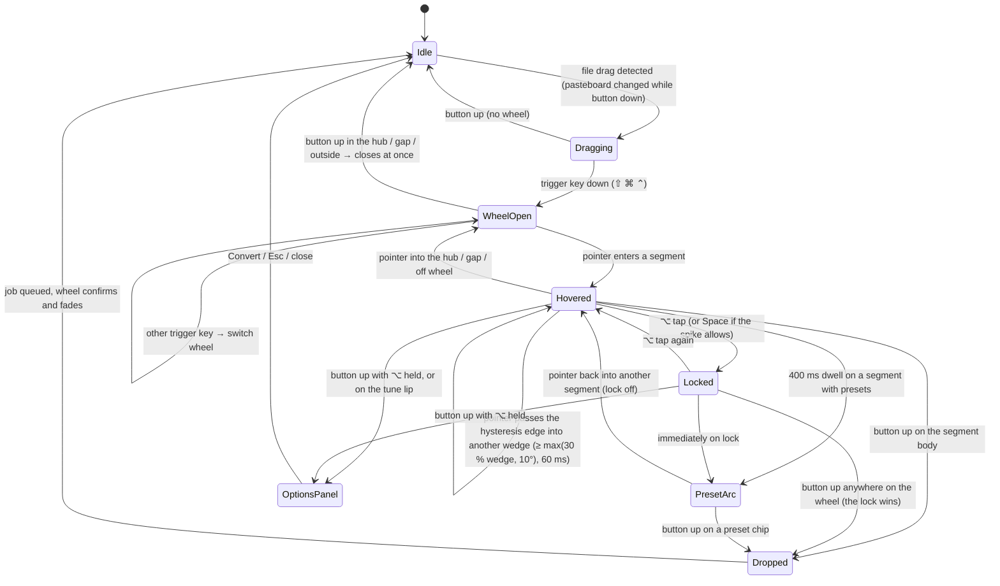

# Halo phase 2 plan: wheel UX, redesign, polish, activation, agents, API

Status: **proposal, awaiting approval.** Nothing in this plan has been built.
Written 2026-10-18 against `main` @ `ce5afb3`.

---

## 0. Audit (done before writing this plan)

### What was run

| Check | Result |
|---|---|
| `make build` | ✅ exit 0 |
| `make test` | ✅ exit 0. App and core: **790 passed, 0 failed, 4 skipped** of 794 (xcresult). Skips are opt-in perf/gallery tests (`HALO_PERF`, `HALO_GALLERY_OUT`). DragSense **106/106**, RadialMenu **50/50**. Entitlements and duplicate-file checks pass. |
| `make matrix` | ✅ **793/793** routes pass on fixtures. 59 input formats, 0 without fixtures, 0 table issues. 516 routes shown on the wheel by default. |
| Live walk-through | Partly by you on real hardware today (log evidence in BLOCKERS B-001): drag detection, ⇧ wheel, ⌘/⌃ switching, drop → converted PDF→PNG, centre drop closes, key → visible 43–45 ms in Release. **I can't synthesise drags or clicks** from this session (no Accessibility / event-posting permission), so the menu-bar menu, Settings and progress windows weren't clicked live by me. |
| Before screenshots | `docs/screens/before/`: the 132 committed offscreen renders (wheel, progress, options, onboarding, settings, editors, cloud, float; light, dark and contrast) including the demo GIF, plus one live capture of the real onboarding window (`live-onboarding-welcome.png`). The live capture was taken by window ID, so nothing else on your screen is in it. |

### What works / what's broken / what's missing vs BUILD.md

| Area | Works | Broken (becomes a Phase A task) | Missing vs BUILD.md / your new asks |
|---|---|---|---|
| Drag detection + wheels | ⇧/⌘/⌃ open on key-down with no permissions; switching; drop on segment; centre cancels; 43–45 ms live | — | Opening straight onto ⌘/⌃ not tried by hand; latency n = 3 (no real p95) |
| Wheel options | Per-format schemas (JPG, WebP, HEIC/AVIF, GIF w/fps, video, MP3, PDF render, archive…); popover accepts a drop | **Mid-drag the only way into options is a 0.6 s hover dwell.** Docs say "right-click / hover-hold", but right-click is impossible while the button is held. The dwell is exactly what causes your mis-aim problem | Presets (none exist); option lock; drop-to-configure |
| Conversions | 793 routes, validated outputs | — | JPEG XL, camera RAW (B-009), PPT/KEY/ODP without the Office pack |
| Tools / actions / Float | 26 local + 3 Pro tools, 6 actions, shelf | — | Shelf Quick Look + arrow keys; annotate text on the canvas; Move undo |
| Onboarding | 4 pages: live demo, permissions coach, launch at login, updates | **Copy is stale:** it says "tap ⇧ Shift" but key-down is the default now. The UI test only checks a window exists | Licence/activation step; a first-run reset script; a full-flow UI test |
| Settings | 7 panes; Formats pane edits per-format defaults | — | Preset editing; activation section |
| Cloud client | OAuth+PKCE sign-in, Keychain, entitlements, share links, cloud jobs, inbox | **Sync does nothing.** `CloudServices.setSyncSource` is never called (`CloudServices.swift:82`), so `SyncEngine.syncNow` returns early (`SyncEngine.swift:114`) and the "Sync Now" button silently no-ops. CHECKLIST #3 claims the cloud client is complete | Public conversion API, API keys, webhooks, usage metering |
| CLI | `convert`, `tool`, `formats`, `tools`, `route`, `version`; `--json` on `formats`/`tools` only | **No tests at all** for CLI output | `targets`, `options`, `presets`, `jobs`, `doctor`, `schema`; `--json` everywhere; NDJSON progress; `--dry-run`; `--overwrite`; MCP server; agent skill; Homebrew *formula* (only a cask template exists) |
| Design system | One token file exists | **Tokens aren't the single source.** ~120 hard-coded colours across ~30 files, 37 literal font sizes, literal radii in 19 files, and RadialMenu ships its own palette. The look is the purple "iris" scheme you called slop | Everything in §2 |
| Packaging | DMG, Sparkle, cask template, 3 CI workflows | — | Signing/notarisation (B-002), feed URL (B-005), CI never run (B-004) |
| Haptics | Wired | Best effort only: macOS ignores haptics from an inactive app, which Halo always is mid-drag (`RadialMenuView.swift:502`). Documented, can't be fixed with public API | — |

Hard stops still open and unchanged by this plan: B-002, B-003 (UI tests need `sudo automationmodetool …`, which matters for Phase F), B-004, B-005, B-006, B-007, B-008, B-010–B-013.

---

## Phases, in order

Effort is wall-clock for an unattended run on this machine, including tests and docs. "∥" marks work that can run as parallel sub-agents in separate worktrees without touching the same files.

### Phase A: fix what the audit found (≈ 3 h)

1. **Sync:** wire a real `SyncDocumentSource` for the namespaces that have local data (format defaults, favourites, hidden formats; presets once Phase B adds them), or hide "Sync Now" until it has something to sync. **Recommendation: wire it** for settings now and for presets in Phase B. Files: `Sources/Cloud/CloudServices.swift`, `SyncEngine.swift`, `Sources/App/AppSettings.swift`, plus a new `Sources/Cloud/SettingsSyncSource.swift`. Test against the mock server. Correct CHECKLIST #3.
2. **Onboarding copy** for press mode ("Press ⇧ Shift mid-drag: tap or hold"), driven by the activation setting so it can never drift again. Files: `Sources/App/Onboarding/*`.
3. **Docs truthfulness:** PARITY / POLISH_AUDIT stop claiming right-click options mid-drag (Phase B replaces the dwell anyway).
4. **CLI golden tests** for the current commands, before Phase G changes them. New target `CLITests` running the built `halo` binary.
- ∥ 1, 2+3 and 4 touch disjoint files.
- Verify: unit tests, mock-server sync test, and `make test` green.

### Phase B: wheel UX, so configuring never fights aiming (≈ 1.5 days)

**Root cause:** aiming and configuring share one pointer mid-drag, and the only way into options is "hold still over a segment for 0.6 s". Fix: aiming happens during the drag, configuring happens after it.

**Your direction, kept or challenged:**

| Your idea | Verdict |
|---|---|
| Drop runs; ⌥-drop configures | **Keep.** Plain drop = convert with remembered settings. ⌥ held at drop = the wheel closes and a **pinned options panel** opens for that format. Finder's ⌥ "copy" meaning is harmless, because we always copy. If ⌥ has been remapped as a trigger key, the fallback is the tune lip below. |
| Tune lip on the segment edge | **Keep, as the discoverable twin of ⌥.** A thin outer lip on segments that have options (with a small "Tune" label on hover). Dropping on it = same as ⌥-drop. |
| Sticky selection | **Keep, with stronger numbers.** Today there's only 1.5° angular hysteresis. Proposed: leave a segment only after moving **≥ 30 % of the wedge angle past its edge, or ≥ 10° (whichever is larger), held for 60 ms**. The ring boundary gets ±6 pt. Starting values, tuned by feel with a debug overlay, then recorded in DECISIONS. |
| Space to lock | **Challenge.** Mid-drag Finder is the key app and our panel is non-activating, so we never receive Space or arrow keys. Seeing them would need Input Monitoring, which breaks the zero-permission promise. A 30-minute spike will test whether `CGEventSource.keyState` sees Space without a permission. If it does, Space locks. **If not, ⌥ *tap* = lock/unlock** (a tap, distinct from ⌥ *held at drop*), shown by a lock glyph and a ring outline. Arrows can't work mid-drag either way. They keep working in keyboard mode (Services / Return), where we are key. |
| Presets arc | **Keep.** When a segment is locked (or dwelled 400 ms), a secondary arc of up to 3 chips appears outside it, e.g. GIF: "Small · 10 fps · 480 w", "Smooth · 24 fps · 720 w", "Last used". Drop on a chip = convert with it. |
| Options from the registry | **Already true for schemas. Extend it:** presets are `OptionValues` stored against a schema id and validated against it. Panel, arc, Settings, CLI (`halo presets`), MCP and API all read the same `OptionsSchema` and the same `PresetStore`. No per-format UI. |
| Settings › Formats edits defaults + presets | Defaults already exist there. Add preset create/rename/reorder/delete, plus "Remember as default" from the pinned panel. |

Pinned options panel: a real key window (the drag is over, so we can take focus). It shows the schema form plus **live estimates**: output size (from a 2 s sample encode for video/GIF, or a quality-curve estimate for images), duration, and frame count for GIF. Buttons: **Convert** (primary), **Remember as default**, **Save as preset**. Esc closes it with nothing written.

**Interaction states**

- **Pointer:** moves between wedges past the hysteresis edge; the button-up position decides drop, chip, lip or cancel.
- **Keyboard mid-drag:** trigger keys switch wheels. ⌥ tap locks (or Space, if the spike allows). ⌥ held at drop opens the panel. Nothing else is visible to us mid-drag.
- **Keyboard mode** (Services / Return): arrows move, Return drops, ⌥-Return opens the panel, Space locks, Esc cancels.
- **Trackpad:** identical to the pointer. Three-finger drag counts as button-down, and lifting the fingers is button-up. Force-click isn't used: it's unreliable mid-drag.

Files: `Packages/RadialMenu` (hysteresis, lock, lip and arc geometry + hit-testing, tests), `Sources/Wheel` (controller states, pinned panel, estimates), `Sources/Shared/Options.swift` + new `Sources/Shared/Presets.swift`, `Sources/Settings/Panes/FormatsPane.swift`, DragSense (⌥-tap lock signal: a modifier tap that isn't a trigger).
- ∥ RadialMenu geometry/hit-testing ↔ PresetStore + Settings ↔ estimate engine (`Sources/Engine/Estimates.swift`). The wheel-controller integration comes last.
- Verify: unit tests for hysteresis numbers, lock, chip and lip hit-testing, and the state machine; a debug overlay to tune by feel; gallery renders of every state; you test the feel on hardware (B-001 gets a new step).

### Phase C: redesign, with **your approval checkpoint on direction** (≈ 2.5 days after approval)

Direction is in §2 below. **The first thing built is a direction board, not the app.** `make gallery` renders the wheel, options panel, a progress card and onboarding page 1 in the new tokens into `docs/screens/after/direction/`. That's a BLOCKERS stop for your yes. Everything else runs while it waits (Phases D-prep, F, G and H don't depend on the visuals).

After approval:
1. `Sources/Shared/DesignTokens.swift` rebuilt as **primitives → semantic → component** tokens (colours, type scale, spacing, radii, motion, durations). A lint script (`scripts/check-tokens.sh`, part of `make test`) fails on any colour, font size or radius literal outside the token file and an allow-list (document writers, image-editor pixel values).
2. RadialMenu (MIT package) gets the tokens through its existing `RadialMenuStyle` (Halo injects them), so the package stays independent.
3. Surfaces: wheel, options panel, progress cards, onboarding, settings, menu-bar menu, Float shelf, toasts, editors' chrome, cloud screens, app icon, menu-bar glyph.
4. Format glyphs: our own designed treatment. Uppercase heavy format names ("GIF", "MP4") as the segment's hero, plus a small kind mark (still / moving / sound / page / box) drawn as vector paths, not SF Symbols.
5. `docs/REDESIGN.md`: a side-by-side page (before from `docs/screens/before/`, after from `docs/screens/after/`), per surface, in light, dark and contrast.
- ∥ After tokens land: (wheel + glyphs) ↔ (progress + toasts + menu) ↔ (settings + onboarding) ↔ (editors chrome + float + cloud screens) ↔ (icon + menu-bar glyph).
- Verify: token lint; contrast unit test over every semantic pair (AA 4.5:1 for body, 3:1 for ≥ 18 pt bold); gallery in Increased Contrast, Reduce Transparency and Reduce Motion; before/after page.

### Phase D: polish pass (≈ 1.5 days)

- **One motion system:** named curves in tokens (`snap`, `glide`, `settle`, `exit`) with durations, used by wheel open/close, hover, lock, preset arc, drop confirm, progress and success. Reduce Motion swaps every curve for a ≤ 120 ms crossfade.
- **Sound and haptics:** subtle drop and success sounds, off by default. Haptics only where macOS delivers them (keyboard mode, the panel); the mid-drag limit is documented.
- **Every surface gets empty / loading / error / success states.** Errors use human copy plus **Copy details** (the engine command, its stderr tail and versions, with paths redacted to `~`).
- **Micro-details:** cursor feedback on lip and chips; focus rings in tokens; VoiceOver labels and order per state (including locked and preset chips); windows open near the drop point on the drop's display; multi-display edge push-in tests.
- Re-measure perf in Release: key → visible p95 over ≥ 20 samples (in-app probe, needs you once, as a B-001 step), idle CPU, idle memory, launch.
- `docs/POLISH_AUDIT.md` v2: every surface, what's worse than a top-tier Mac app, and the fix.

### Phase E: onboarding + optional Pro activation (≈ 1 day)

Flow: **welcome → live drag demo → permissions coach → launch at login → updates opt-in → "Have a Pro key or account? Activate / Skip".**

- Skip is the primary-looking path. There are no nags afterwards, and no Pro prompts outside cloud features.
- Activation is also reachable from Settings › Account and the menu bar.
- Two ways to activate:
  - **Sign in** (existing OAuth + PKCE).
  - **Paste a licence key.**
- Licence key format: `HALO1-<base32(payload)>-<base32(sig)>`. The payload is compact CBOR or JSON: plan, seats, expiry, key id, account hint, issued-at. It's signed with **Ed25519** (CryptoKit `Curve25519.Signing`, available on macOS 13). Halo ships the public keys with key ids, so they can be rotated.
- Verification is offline. The key is stored in the Keychain. Deactivate / transfer is in Settings; it's local removal plus a best-effort server revoke when signed in.
- **What a key unlocks:** only the Entitlements gate (`Sources/Cloud` + `Wheel/CloudSegments.swift`), exactly as today. Cloud calls still need the server; a key alone can't upload anything. So a key is mainly for teams/offline seats and as proof of purchase. The existing entitlement-grep check keeps local features ungated.
- Files: `Sources/App/Onboarding/*`, new `Sources/Cloud/Licence/{LicenceKey,LicenceVerifier,LicenceStore}.swift`, Settings › Account, the openapi additions (`/licences/activate`, `/licences/{id}/revoke`).
- ∥ Licence crypto + store (pure, testable) ↔ onboarding UI.
- Verify: test vectors (valid, expired, wrong key id, tampered, truncated); the entitlement grep; onboarding renders.

### Phase F: test onboarding properly (≈ 0.5 day, plus whatever B-003 allows)

- `scripts/reset-first-run.sh`: it says exactly what it resets, and asks nothing.
  - `defaults delete dev.aiwithaj.halo`.
  - The Keychain items for service `dev.aiwithaj.halo*`.
  - `~/Library/Application Support/Halo`, Caches and Logs.
  - The CLI symlink, if we installed it.
  - The login item via `SMAppService` unregister.
  - `tccutil reset All dev.aiwithaj.halo` (no sudo needed for your own bundle id's user-level grants).
- Permission paths as UI tests with a **fake permission probe** injected through a launch argument, so all four paths run without touching real TCC: all granted, all denied, granted mid-flow, revoked after onboarding. A real-TCC pass is in the manual checklist.
- UI tests walk the full flow and screenshot every step into `docs/screens/onboarding/`. These need Automation Mode (**B-003**). Until you run that one `sudo` command, the same flow runs as an offscreen render test (already possible), and the UI tests stay written and runnable.
- `docs/ONBOARDING_CHECKLIST.md`: 5 minutes, by hand.

### Phase G: CLI + MCP, built for agents (≈ 1.5 days)

- **Commands:** `halo convert`, `targets <file>`, `formats`, `options <format>`, `tool <tool> <file>`, `presets [list|show|add|rm]`, `jobs` (local job history from the app's store), `doctor` (engines, versions, signature, packs, PATH, permissions it can detect), and `schema --json` (every format, route, tool, option schema and preset; versioned with `schemaVersion`).
- **Contract:**
  - `--json` on everything. NDJSON events on stdout (`start`, `progress {pct}`, `output {path}`, `done`, `error {code,message}`). Logs on stderr.
  - Never prompts.
  - `--dry-run` prints the route, engines and final output path.
  - `--out-dir`; `--overwrite never|rename` (default rename, Finder style, via the existing `OutputNamer`).
  - Stable documented exit codes: 0 ok, 2 usage, 3 unsupported route, 4 input missing/unreadable, 5 engine failed, 6 partial batch, 7 cancelled, 8 cloud unavailable.
  - The current codes (64–69) map onto these, documented in `docs/CLI.md`.
- **One registry:** the CLI already links HaloCore. Options, presets and schema come from the same `OptionsSchema` / `PresetStore` the wheel uses.
- **MCP:** `halo mcp` over stdio. Tools: `convert`, `targets`, `options`, `run_tool`, `formats`, `presets`. Progress goes out as MCP progress notifications. No network, no port.
  - Researched today: the official `modelcontextprotocol/swift-sdk` (0.12.1, 2026-05-07) is MIT/Apache-2.0, so AGPL-compatible, and supports macOS 13. But it pulls in SwiftNIO and a docc plugin pinned to `branch: main`, and it targets spec **2025-11-25**, while the newest spec release is **2026-07-28**.
  - **Recommendation:** a small hand-written stdio JSON-RPC server inside the CLI (no new dependencies, ≈ 500 lines). It negotiates protocol versions and supports 2025-11-25 first (what most clients speak), then adds 2026-07-28 once I've read its changelog during the phase. It's verified with the official MCP Inspector / conformance tests. The decision goes in DECISIONS.
- `agents/SKILL.md` with worked examples (plan with `schema`, dry-run, convert with NDJSON, MCP config for Claude Code).
- **Install:** the Settings button already symlinks `halo` into PATH. Add a Homebrew **formula** that installs the CLI only, from the release tarball, in `packaging/homebrew/halo-cli.rb`, next to the existing cask.
- **Tests:** golden files for every `--json` output and the NDJSON stream (normalised paths and timings), exit-code tests, an MCP request/response golden transcript.
- ∥ CLI commands ↔ MCP server ↔ docs/skill, once the shared `--json` encoders land.

### Phase H: public conversion API contract + SDK (≈ 1.5 days, client side only)

- Extend `Server/openapi.yaml`:
  - **API keys** per account: create, list, revoke, with scopes.
  - `POST /v1/conversions` (from upload id or URL, target, options validated against the same schema ids).
  - `GET` / poll it, `DELETE` to cancel, `GET` the result download.
  - **Webhooks:** register, list, delete; signed with HMAC-SHA256 plus a timestamp to stop replays.
  - `GET /v1/formats` and `/v1/schema`.
  - **Usage:** `GET /v1/usage`, meter per conversion and per media minute.
  - **Rate limits:** `RateLimit-*` headers + 429 with `Retry-After`.
  - **Idempotency keys** on create.
- `packages/sdk` (TypeScript): types generated from the OpenAPI file, a thin hand-written client (upload with resume, poll or webhook-verify helper), tested against the mock server.
- The CLI's `--cloud` flag goes through the existing Swift cloud client (contract-tested against the same mock).
- Mock server (`Tests/Mock/server.mjs`) gains the new operations. The contract test runs in `make test`.
- Still no local HTTP server.
- **Real server: a separate later phase, not built now.** Recommendation and rough cost are in Risks / decisions below.

---

## 2. Redesign direction (needs your approval)

### Palette (sampled from the reference, then adjusted for contrast)

Hex values from pixel sampling of the reference (marked *s*) or derived for AA contrast (marked *d*).

| Primitive token | Hex | Source / use |
|---|---|---|
| `ink.1000` | `#000000` | *s* page black, deepest backdrop |
| `ink.950` | `#0A0A0A` | *d* window background (dark hero) |
| `ink.900` | `#1F1F1F` | *s* charcoal tiles / cards |
| `ink.800` | `#2A2A2A` | *d* raised controls, wheel segments at rest |
| `ink.500` | `#6E6E6E` | *s* the reference's dimmed display text: **large type only** (3.2:1 on charcoal) |
| `ink.400` | `#9A9A9A` | *d* secondary text on charcoal (5.9:1) |
| `paper.0` | `#FFFFFF` | *s* (sampled `#FFFEFF`) primary text on dark, light-mode surface |
| `cobalt.500` | `#2766EE` | *s* primary pill, progress fill, focus. White text on it: 5.0:1 ✅ |
| `cobalt.400` | `#5B8CFF` | *d* cobalt as text/glyph on black (6.3:1) |
| `cobalt.700` | `#1D4FD8` | *d* light-mode cobalt text on white (6.6:1) |
| `cobalt.top` | `#3E28D1` | *s* top of the blue band gradient only, never a fill on its own, so it can't drift into the banned violet |
| `orange.500` | `#FF9500` | *s* secondary pill, highlight. **Text on it is black** (9.6:1); the reference's white-on-orange is 2.2:1, so we don't copy that |
| `orange.600` | `#FF7D00` | *s* gradient mid band |
| `flame.500` | `#FF4C00` | *s* hot red-orange: errors/destructive, big numerals. White text only ≥ 18 pt bold (3.3:1); black text 6.3:1 |
| `flame.600` | `#FF2600` | *s* gradient hot end |
| `ember.700` | `#C91B00` | *s* deep red band |
| `peach.200` | `#FFCAA0` | *s* the orange → white fade |
| `cream.100` | `#FFF0D9` | *s* the last band before white |

Semantic tokens (dark / light):
- `bg.window` ink.950 / paper.0; `bg.tile` ink.900 / `#F2F2F2`.
- `text.primary` paper.0 / ink.950; `text.secondary` ink.400 / `#5C5C5C` (6.7:1).
- `accent.primary` cobalt.500; `accent.secondary` orange.500.
- `state.error` flame.500 (always with an icon + label).
- `state.success` cobalt.500 + a check glyph. No green; meaning never rides on colour alone.
- `focus.ring` cobalt.400.

Component tokens:
- `wheel.segment.rest` ink.800; `wheel.segment.hover` = the band gradient; `wheel.segment.locked` = a cobalt outline 2 pt + lock glyph.
- `pill.primary` cobalt.500 / white; `pill.secondary` orange.500 / black.
- `progress.fill` cobalt band gradient; `numeral.stat` paper.0 on dark.

**Signature move: banded gradients.** The vertical "stripes of light" become a fixed recipe:

| Name | Bands | Used for |
|---|---|---|
| `band.heat` | flame.600 → orange.600 → orange.500 → peach.200 → cream.100 → paper.0 | Hovered segment, success numerals' backing, onboarding hero |
| `band.cobalt` | cobalt.top → cobalt.500 → `#2E6BF2` | Progress, primary moments |

- 5–7 bands each, hard edges, each band a vertical linear fade.
- Used **once per surface**, like a spotlight. Everything else is black and charcoal.
- Reduce Transparency and Increased Contrast swap bands for a flat fill plus an outline.

### Type

- **Display: Inter Display** (Inter v4.1, OFL 1.1, verified from `rsms/inter` LICENSE.txt and its latest release 2024-11-16), Black/ExtraBold, uppercase, tracking −2 % to −4 %.
  - Used for format names on the wheel, big numerals (output size, "−62 %", progress) and onboarding headlines.
  - We bundle only the display weights we use (subset), with the OFL text in `LICENSES/`.
- **Body / labels: SF Pro** (the system font), not bundled. It's the right body face on a Mac (Dynamic Type, localisation, no extra size).
- Type scale tokens: `display.xl 64`, `display.l 40`, `display.m 24`, `title 17`, `body 13`, `label 11`, `micro 10`, with fixed line heights.
- The reference looks like a Helvetica-Now-style display face. That's commercial and can't be bundled in an AGPL app, so we won't try to imitate it more closely.

### Shapes

**Two radii only:** `radius.tile 14` (bento tiles, panels, cards) and `radius.pill 999`, plus `radius.segment` from the wheel geometry. **One shadow token** (`elevation.float`), used only for floating windows.

### Mood, three surfaces

- **Wheel:** a black disc with charcoal wedges and huge uppercase format names, like a record label. The wedge under the pointer lights up in the heat band, as if a stage light swung onto it. Locked: a cobalt ring snaps around the wedge with a small lock mark. Preset chips sit outside the rim as small pills. Nothing glows, nothing is blurred.
- **Options panel:** an editorial spec sheet. "GIF" set huge at the top left; under it, three bento tiles with big numerals: **2.4 MB**, **4.8 s**, **116 frames**, updating as you slide. Controls in a tight two-column grid. One blue pill (Convert) and one orange pill (Save preset) at the bottom right. Left-aligned throughout.
- **Onboarding:** full-bleed black pages with one banded gradient each, like a poster wall. Headlines in heavy uppercase ("DRAG. PRESS. DROP."). The live demo sits in a charcoal tile. Copy is short and plain. Skip sits bottom left in plain text; Continue is a blue pill. The licence page is quiet: one sentence, an Activate pill, and a Skip that reads like the default.

---

## Open decisions (with my recommendation)

| # | Decision | Recommendation | Why |
|---|---|---|---|
| 1 | Lock gesture mid-drag | Space if the 30-min spike shows `CGEventSource.keyState` sees it without a permission; otherwise **⌥ tap** | We can't receive key events mid-drag without Input Monitoring, and the zero-permission promise matters more |
| 2 | Configure gesture | **⌥ held at drop + tune lip**, and remove the 0.6 s dwell popover mid-drag | The dwell is what mis-aims; post-drop configuring has nothing left to mis-aim |
| 3 | Fonts | **Inter Display** (bundled, OFL) + **SF Pro** body | Verified licence, closest heavy grotesk, one extra font family only |
| 4 | Licence keys | **Ed25519-signed offline keys**, Keychain, key ids for rotation | Works offline, no secret in the app, CryptoKit is built in on macOS 13 |
| 5 | Business model | **Keep: local free forever, paid cloud (Pro/Team) + pay-per-use API.** Don't charge for commercial use of local features | AGPL means anyone can build and use it commercially from source, so a commercial-use fee only taxes honest users and contradicts BUILD.md's promise. Cap's commercial licence works because Cap is open-core with paid hosted parts; ours already are (cloud + API). If you want revenue from businesses: Team plan (seats, shared links/domains), API, priority support. |
| 6 | MCP implementation | **Small in-house stdio server, no SDK dependency** | Avoids SwiftNIO + an unpinned docc plugin in a CLI binary; the stdio surface is small and testable with the official Inspector |
| 7 | CLI exit codes | **New compact set 0–8** (above), old ones documented as mapped | Agents branch on codes; sysexits' 64–69 are too coarse for "partial batch" vs "engine failed" |
| 8 | Sync | **Wire it** (settings now, presets in Phase B) | It's claimed done and the button is live; hiding it would be a regression |
| 9 | Real API server stack (later phase) | **Hetzner dedicated/CCX workers + Cloudflare R2 (no egress fees) + Postgres + a queue; Stripe metered billing** | Transcoding is CPU-bound and egress-heavy: cheap cores and zero-egress storage dominate cost |
| 10 | Price shape for the API | **Per conversion, with media-minute pricing for audio/video** | Rough cost per conversion (an estimate, to be priced properly in the server phase): images/docs ≈ $0.0002–0.001; 1 min 1080p video ≈ $0.002–0.006 compute + storage. A $0.01 image / $0.02-per-minute video price leaves margin for retries, storage and support |

## Risks and things you may have missed

- **B-003 decides how much of Phase F is automated.** Without the one `sudo automationmodetool …` command, onboarding UI tests stay written but not run. Offscreen renders and the fake-probe unit tests still cover the logic.
- **Feel needs your hands.** Hysteresis numbers, the lock and the preset arc are tuned by me with an overlay and unit tests, but only you can judge them mid-drag. Each phase adds a short B-001 step rather than stopping the run.
- **Redesign scope creep:** ~120 hard-coded colours across ~30 files, editors included. The token lint makes "done" measurable. Editor *pixel* colours (user content) are allow-listed, not themed.
- **Live estimates for video/GIF** cost CPU. A 2 s sample encode is capped, cancellable, and runs only while the panel is open, so idle budgets stay intact.
- **⌥ conflicts:** ⌥ can be remapped as a trigger key in Settings. If it is, the lip and the keyboard-mode path still work, and Settings warns.
- **Accessibility of the banded style:** bands behind text fail contrast in places, so text never sits on the pale end of a band. A contrast test enforces it.
- **The latency margin is thin** (43–45 ms of a 50 ms budget). A heavier redesign could push it over. Phase C keeps segment drawing in pre-rendered layers, and Phase D re-measures with ≥ 20 samples.
- **Licence keys don't stop a determined user**, and needn't. They gate nothing local, and cloud enforcement is server-side.
- **Signing (B-002):** without Developer ID, a bundled font and new helpers are still ad-hoc signed. Fine for dev, not for release.
- You didn't mention it, but Phase G should also give the CLI **`halo open-wheel <files>`** (show the wheel for files from Terminal) so agents and scripts can hand off to the GUI. Cheap, and useful for "convert with my preset" flows.

## How I'll run it once approved

Unattended. Small commits on `main`, `make test` green on every commit, and PARITY/DECISIONS updated as I go. The only planned hard stop is the **direction approval in Phase C**. It goes into BLOCKERS with the board's path, and the other phases continue meanwhile. Feel checks and B-003 go into BLOCKERS as asks, not stops.
