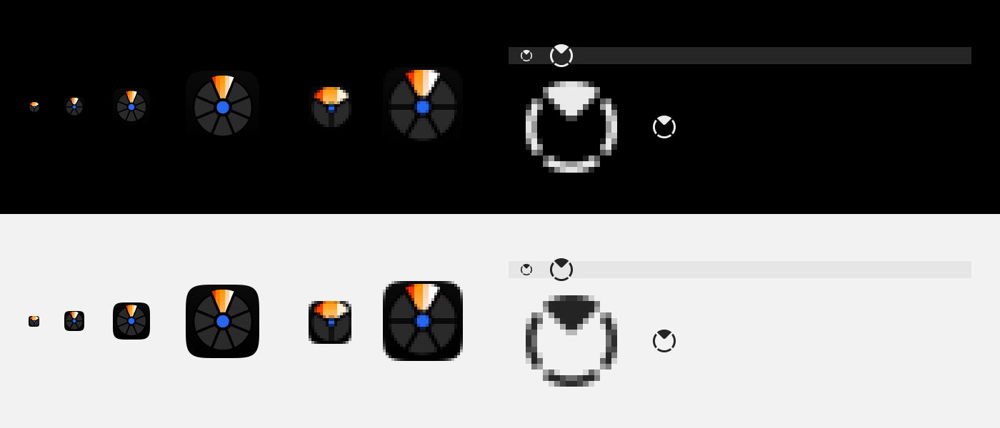

# Icons

Halo's app icon, menu bar glyph and DMG background are drawn by script, from the phase 2 palette (`docs/PLAN-PHASE2.md` §2). No downloaded, traced or generated artwork. The output is deterministic: the same script gives the same pixels.

```sh
swift scripts/make-icons.swift Sources/App/Resources/Assets.xcassets
swift packaging/dmg/make-background.swift <out-dir> Halo   # run by packaging/make-dmg.sh
```

`make-icons.swift` writes:

| Output | What |
|---|---|
| `Assets.xcassets/AppIcon.appiconset/*` | 16–512 pt at @1x/@2x (16 → 1024 px), plus `Contents.json` |
| `Assets.xcassets/MenuBarIcon.imageset/*` | template glyph, 18×18 pt at @1x/@2x, plus `Contents.json` (`template-rendering-intent: template`) |
| `docs/screens/app-icon.png` | 1024 px master (used by the README) |
| `docs/redesign/icon-sizes.png` | preview strip: 16/32/64/128 at actual size and 16/32 magnified 4× on black and on light grey, and the menu bar glyph on dark and light bars |



## App icon

- **Shape:** macOS Big Sur+ grid. An 824/1024 continuous-corner squircle (superellipse, n = 5) centred on the 1024 canvas, with one soft shadow below it at 256 px and up only.
- **Surface:** `ink.950` #0A0A0A at the top fading to `ink.1000` #000000 at the bottom.
- **Mark:** the conversion wheel itself. A black disc holds a ring of `ink.800` #2A2A2A wedges around the hub, separated by constant-width gaps (parallel edges, like the real wheel).
- **The lit wedge:** the wedge at 12 o'clock carries `band.heat`: #FF2600 #FF7D00 #FF9500 #FFCAA0 #FFF0D9 #FFFFFF. These are vertical, hard-edged bands, each fading a little toward the next colour from top to bottom. The wedge steps out past the rim, the way the hovered wedge does in the app. That gradient is the icon's one spotlight.
- **Accent:** the hub is solid `cobalt.500` #2766EE, inside a black ring. That's the only cobalt.
- **Not used:** purple, glass, glow, blur, or extra shadows.

### Small sizes are simplified, not scaled down

| Pixel size | Wedges | Bands in the lit wedge | Body |
|---|---|---|---|
| ≥ 200 | 8 | all 6 | 824/1024 + shadow |
| 48–199 | 8, wider gaps | 5 (drops cream) | 824/1024 |
| 24–47 | 6 | 4 | 88 % of canvas at ≤ 32 px, else 824/1024 |
| < 24 (16 px) | 3 (the lit wedge is a 120° fan) | 3 (flame, orange, cream) | 94 % of canvas |

Gaps, hub and hub ring all grow as a fraction of the size as the icon gets smaller. At 16 px the icon reads as a dark tile with a bright orange fan over a blue dot.

## Menu bar glyph

- **Format:** template image, black plus alpha only, 18×18 pt. AppKit tints it for light, dark and highlighted menu bars. `StatusItemController` loads it as `NSImage(named: "MenuBarIcon")` and sets `isTemplate`.
- **Shape:** a ring of four pieces with a constant gap, like the wheel's rim. The piece at 12 o'clock is filled inward almost to the centre: the lit wedge. There's no hub dot (a wedge over a dot reads as a Wi‑Fi glyph).
- **Weight:** a 1.6 pt ring and 1.6 pt gaps at @1x, so each stroke covers about 1.5 device pixels, close to SF Symbols regular in the menu bar. @2x uses 1.45 pt.
- **Format change:** it ships as two pixel-tuned PNGs and replaces the old vector PDF. macOS image sets don't accept a @3x child (actool warns "unassigned child"), and no Mac display is 3x, so there's no @3x.

## DMG background

- **Layout:** a near-black field (`ink.950` → `ink.1000`) and a caption in white plus `ink.400`.
- **Arrow:** from the app to Applications, drawn as six hard-edged dashes in `band.heat` order with a white head.
- **Labels:** Finder draws icon labels in the system text colour, black in light mode and white in dark mode. So each label sits on a mid-grey pill, #777777, where both colours read at ≥ 4.5:1. The pills are placed for the positions `make-dmg.sh` sets: icons at (165, 195) and (495, 195), 112 pt icons, 12 pt labels.
