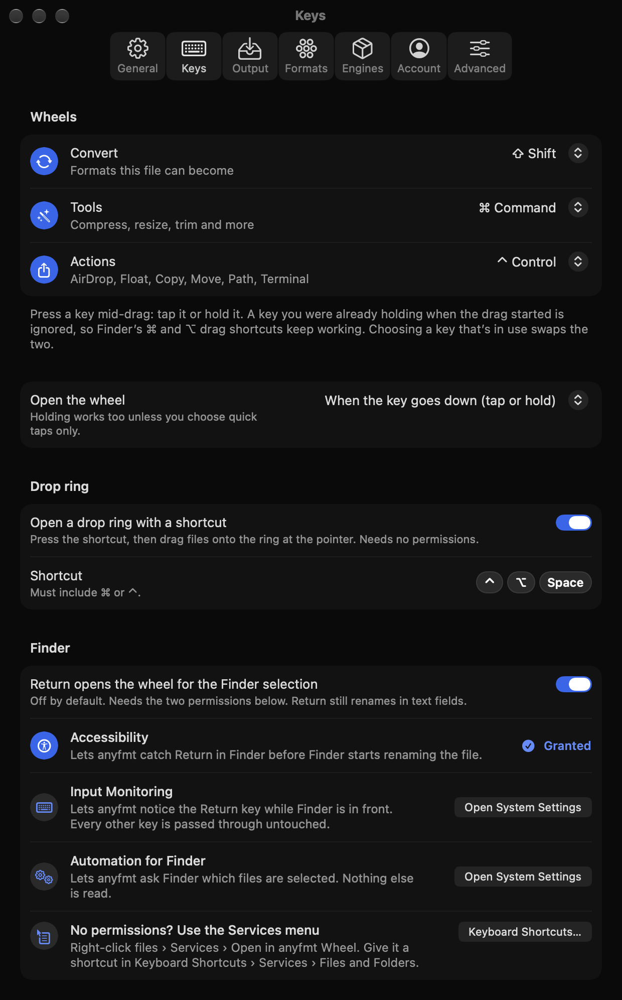
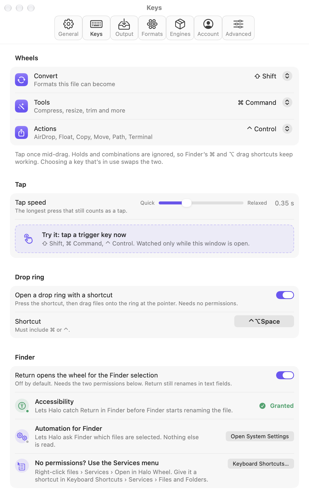
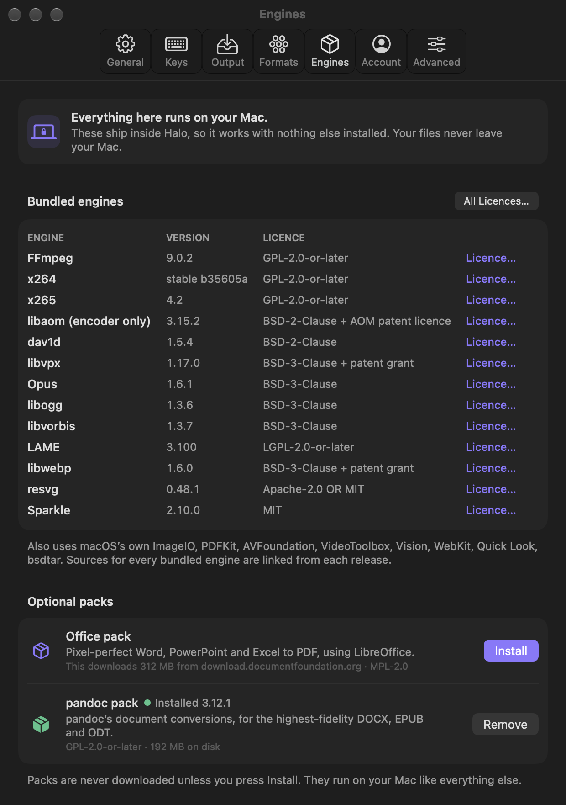
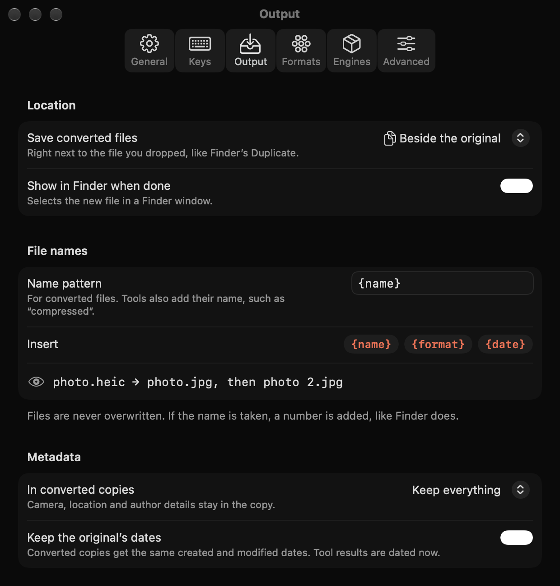
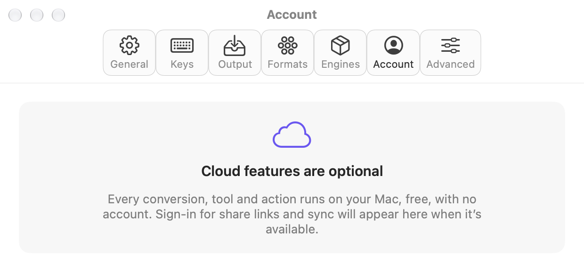
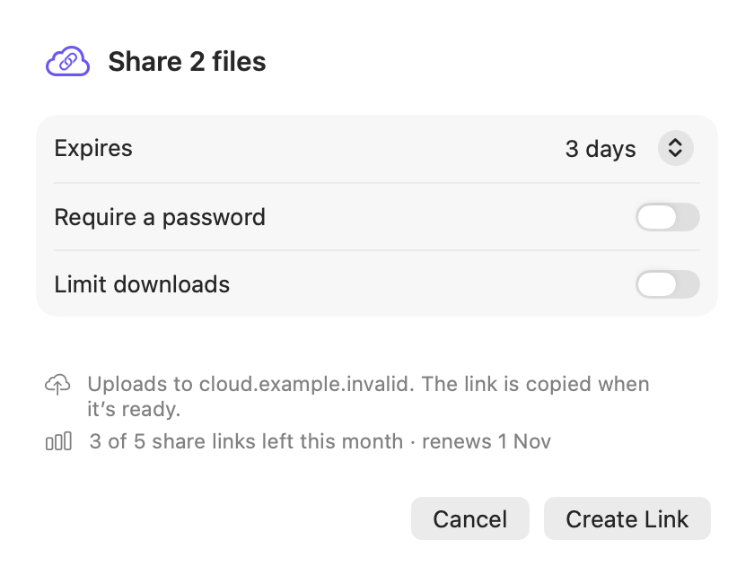
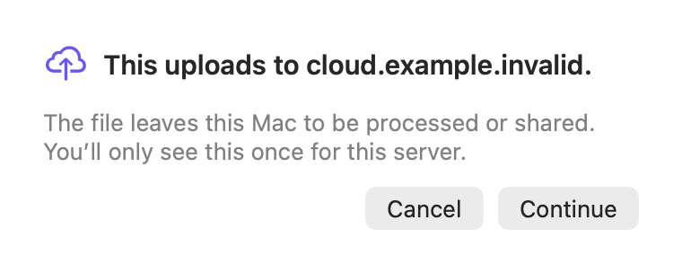
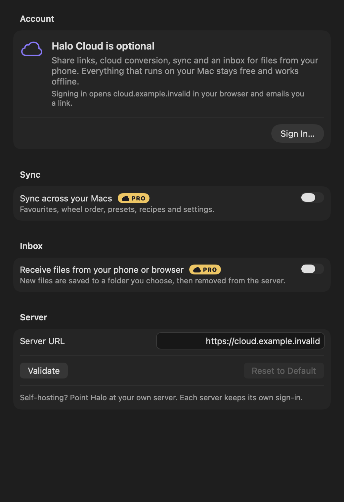

# Settings and cloud screens: phase 2 redesign

Scope: the Settings window (every pane, the hotkey recorder), the cloud screens
(account, Pro explainer, share-link options, upload notice, plan badges,
licence activation) and the small shared controls (`KeyCap`, `StatusBadge`,
`FootnoteText`, `FormatChip`, `CardToggle`, `AnyfmtSwitchStyle`, and
`OptionsForm` styling). Direction: PLAN-PHASE2 §2 and
`docs/screens/after/direction/` (board 3 and 4, the options panel).

Settings is still a proper Mac Settings window: a `.preference` toolbar and
grouped `Form`s. What changed is the material and the details.

## Before / after

| Screen | Before | After |
|---|---|---|
| Keys, dark |  |  |
| Keys, light |  |  |
| Formats, dark |  |  |
| Engines, dark |  |  |
| Output, dark |  |  |
| Account (no cloud), light |  |  |
| Pro explainer, dark |  |  |
| Share options, light |  |  |
| Upload notice, light |  |  |
| Account, signed out, dark |  |  |
| Badges, increased contrast |  |  |

Every other state (light, dark, increased contrast) is in `docs/screens/settings-*.png`
and `docs/screens/cloud-*.png`.

## What changed

**Window.** The window and toolbar sit on the token surface: near-black
(`ink.950`) in dark, the hero; white in light. Grouped sections read as charcoal
tiles on black. Menus, focus rings and list selection keep the person's own
system accent, as every Mac Settings window does. anyfmt's own controls carry the
cobalt: switches, sliders, pills, glyph tiles.

**Display type, in three places only.** The format name at the top of
Formats › detail ("JPG", like "GIF" on the board), the count of bundled engines
in Engines, and the Account fallback headline. Pane titles stay in the title
bar, where macOS puts them.

**Pills.** Primary actions are cobalt pills with white text (Install a pack,
Sign In, Activate, Create Link, Continue). "Save Current Defaults as Preset" is
the orange secondary pill with black text, as on the board. Cancel / Not Now /
Remove / Sign Out are quiet text buttons. Everything else stays a native
bordered button.

**Shared controls.**
- `KeyCap`: an ink tile with a hairline (white with a light hairline in light
  mode), one radius (`Shape.tile`), no shadow. "Live" keys are cobalt. VoiceOver
  reads modifier symbols as words.
- `StatusBadge`: icon + label. Each tone has its own symbol (check, clock,
  minus, warning triangle), so state never rides on colour. No yellow, no green.
- `FormatChip`: pills from four families only: cobalt (images), orange with
  black text (audio, video), flame with black text (PDF), ink (documents and
  data), grey (archives, other). The old violet, pink and green chips are gone.
- `OptionsForm`: invalid values show a warning glyph and text, not red text
  alone. Help text uses the secondary token (AA) instead of `.tertiary`.
- `anyfmtBorder(_:_:)`: borders drawn as an even-odd ring of fill. Stroked
  rounded paths render with notches at the arc joins in offscreen captures on
  current macOS; fills don't.

**Hotkey recorder.** The shortcut shows as key caps (⌃ ⌥ Space). Click to
record: a pill-shaped well with a cobalt focus ring, "Type a shortcut" and an
esc cap as the cancel hint. Problems show as a warning badge. VoiceOver hears
"Control Option Space" and a recording state.

**Cloud screens.** Editorial and left-aligned. A display headline, one line of
plain copy, the facts in a charcoal tile, a blue pill bottom right. The Pro
explainer is the only cloud surface with a band: a cobalt-band glyph tile
(flat cobalt under Reduce Transparency or Increased Contrast). The Pro chip and
the Pro plan badge are orange with black text (9.6:1), not gold; Team is cobalt
with white; Free is a quiet outlined pill. Increased contrast adds ink outlines.

**States and copy.**
- Formats search with no results: "No formats match “…”" plus a hint.
- Engines: a problem row if the engine list can't be read; the empty packs row
  uses the same empty-state pattern; pack progress shows a percentage.
- Advanced: installing the command-line tool now reports success or a plain
  error inline ("Couldn’t install: … Use Copy Command and run it in Terminal
  instead.") instead of hiding it in a tooltip.
- Output: a missing output folder reads in the error colour, words first.
- Account: errors show with a warning glyph and a Dismiss button; the server
  check shows "Checking…" while it runs; the licence field no longer leaks its
  placeholder as a stray row label.
- Share link: a too-short password explains itself inline; Create Link says
  why it's disabled to VoiceOver.
- "Tap detected ✓ Shift" became "Tap detected: Shift" (the icon carries the check).

**Motion.** The tap test, copied-to-clipboard swap and share-option reveals
skip their animation under Reduce Motion.

**Tokens.** Component tokens live in `Sources/App/Shared/DesignTokens+Settings.swift`
and `+Cloud.swift` (`extension DesignTokens.Component`). `CloudStyle` resolves
them, increased-contrast variants included, from primitives only. Zero
`scripts/check-tokens.sh --report` hits in these files.

## Polish list (not done)

- Settings screenshots have no increased-contrast render: `UIScreenshots`
  (outside this area) only does light and dark. Cloud screens do all three.
- Keyboard focus rings on custom pills come from SwiftUI's default focus
  effect, in the system accent. They're visible, but not cobalt.
- `PermissionsCoachList` (Keys › Finder) belongs to the permissions area and
  still uses its own icon circles; it should move to `SettingsGlyphTile`.
- Key caps are pill-shaped at their height because `Shape.tile` (14) is more
  than half of 22 pt. If a squarer cap is wanted, it needs a third radius token,
  which the brief rules out today.
- The share-link options sheet still uses a grouped `Form` inside an editorial
  panel; a custom two-column grid like the board's options panel would match
  better.
- The Advanced pane has no pills by design (every action there is secondary);
  "Copy Diagnostics" could become primary if support asks for it more.
- Error strings from `CloudSession.lastError` come from `CloudError`, outside
  this area; a copy pass there would make them all as plain as the rest.
